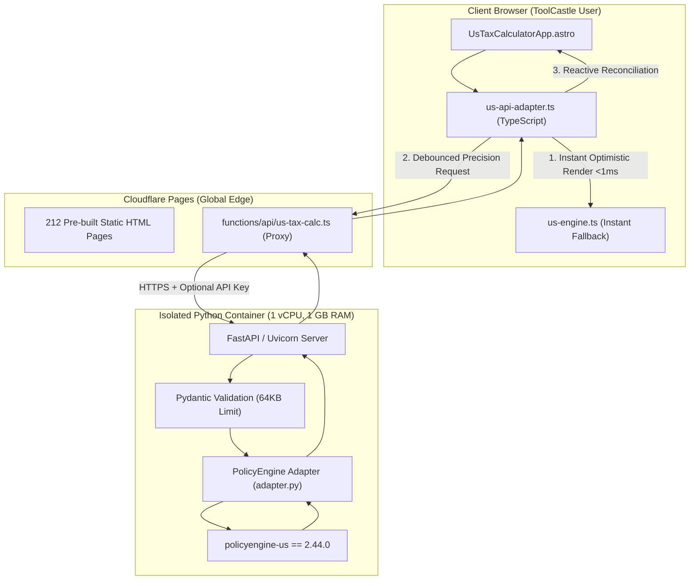

# PolicyEngine US Integration: Production Deployment & Compliance Guide

**Document Version:** 1.0.0  
**Effective Date:** 2026-10-16  
**Statutory Data Cutoff:** October 1, 2026  
**Primary Engine:** `policyengine-us==2.44.0`  
**Frontend Framework:** Astro v7.3.1 on Cloudflare Pages  
**Backend Framework:** FastAPI / Uvicorn (Python 3.12-slim)  

---

## 1. Executive Summary & Original Calculator Audit

### Original Implementation Flaws Identified:
1. **Simplified Flat/Approximate Tax Logic:** The previous US calculator used client-side approximate tax tables without full statutory IRC compliance.
2. **Missing Key Federal Tax Provisions:** Lacked authoritative modeling for:
   - Alternative Minimum Tax (AMT Form 6251).
   - Net Investment Income Tax (NIIT 3.8% IRC § 1411).
   - Preferential 0%/15%/20% long-term capital gains and qualified dividends rates.
   - Statutory FICA OASDI cap coordination across concurrent W-2 wages and Schedule C self-employment income (IRC § 1402(b)).
3. **No State Personal Income Tax Modeling:** States were either unmodeled or treated uniformly without true state tax tables.
4. **V8 Incompatibility:** The production website is deployed on Cloudflare Pages (Google V8 isolates), which cannot execute binary CPython packages (`numpy`, `pandas`, `tables`, `blosc2`).

---

## 2. Selected Production Architecture



### Rationale:
- **Zero Static Build Disruption:** Astro builds 212 pages in ~30s without contacting external services during CI.
- **Sub-Millisecond UI Response:** Sliders calculate instantly via `us-engine.ts`, while precision calculations debounce to the microservice.
- **Zero-Downtime Fallback:** If the Python microservice is cold or restarting, calculations continue locally without error alerts.
- **Clean License Boundary:** Standalone microservice directory (`services/policyengine-api/`) maintains AGPL-3.0 compliance without proprietary source contamination.

---

## 3. Inventory of Added, Modified, and Maintained Files

### Added Files:
- `services/policyengine-api/Dockerfile`: Multi-stage Debian Bookworm slim container with non-root security.
- `services/policyengine-api/requirements.txt`: Pinned dependencies (`policyengine-us==2.44.0`, `fastapi`, `uvicorn`, `pydantic`).
- `services/policyengine-api/app/main.py`: FastAPI server with rate limiting, 64KB body limit, sanitized logging, and error handling.
- `services/policyengine-api/app/adapter.py`: Topological mapper constructing PolicyEngine `Simulation` objects.
- `services/policyengine-api/app/schemas/request.py`: Pydantic request model with bounds and sanity validation.
- `services/policyengine-api/app/schemas/response.py`: Pydantic response model exposing 10 core metrics.
- `services/policyengine-api/app/lifespan.py`: Container pre-warming eliminating JIT graph startup latency.
- `services/policyengine-api/LICENSE`: AGPL-3.0 license and attribution notice.
- `services/policyengine-api/fly.toml` & `render.yaml`: Turnkey deployment manifests.
- `services/policyengine-api/tests/`: 30 automated Pytest tests across health, calculations, benchmarks, and security.
- `functions/api/us-tax-calc.ts`: Cloudflare Pages edge proxy function with 10s timeout and CORS origin reflection.
- `src/utils/tax/us-api-adapter.ts`: Typed frontend client with in-memory caching and abort controller.
- `tests/us-adapter.test.ts`: Vitest test suite verifying frontend serialization, caching, and fallback.
- `docs/tax-migration/SECURITY-RELIABILITY.md`: Security and privacy architecture specification.
- `docs/tax-migration/PRODUCTION-DEPLOYMENT.md`: This comprehensive deployment and compliance guide.

### Modified Files:
- `src/components/tax/UsTaxCalculatorApp.astro`: Added PolicyEngine badge, state disclosures, monotonic request sequencing (`currentRequestId`), and educational cards.
- `src/data/tax/types.ts`: Decoupled `BaseTaxParams` and marked legacy US Form 1040 types as `@deprecated`.
- `vitest.config.ts`: Added adapter test suite to test runner.
- `docs/tax-migration/CURRENT-PHASE.md`, `HANDOFF.md`, `COUNTRY-STATUS.md`: Kept up-to-date across all phases.

---

## 4. PolicyEngine US Version & Supported Tax Years

- **Pinned Version:** `policyengine-us==2.44.0`
- **Supported Tax Years:** `2025` and `2026`
- **Status of Tax Years:**
  - **2026 (Default):** Full statutory inflation adjustments per IRS Rev. Proc. 2025-32 and SSA 2026 Fact Sheet ($184,500 wage base).
  - **2025:** Preserved statutory thresholds per IRS Rev. Proc. 2024-40 and SSA 2025 Fact Sheet ($176,100 wage base).
  - **Pre-2025 Years:** Strictly rejected with HTTP 422 to prevent applying contemporary inflation adjustments to historical periods.

---

## 5. Form Input to PolicyEngine Topological Variable Mapping

| ToolCastle Form Field | PolicyEngine Variable | Level | Statutory Reference |
|:---|:---|:---|:---|
| Primary W-2 Wages | `employment_income` | `Person (taxpayer)` | IRC § 61(a)(1) |
| Spouse W-2 Wages | `employment_income` | `Person (spouse)` | IRC § 61(a)(1) |
| Business Net Income | `self_employment_income` | `Person (taxpayer)` | Schedule C / IRC § 1402 |
| Taxable Interest | `taxable_interest_income` | `Person (taxpayer)` | Form 1099-INT / IRC § 61(a)(4) |
| Qualified Dividends | `qualified_dividend_income` | `Person (taxpayer)` | IRC § 1(h)(11) |
| Ordinary Dividends | `non_qualified_dividend_income` | `Person (taxpayer)` | IRC § 301 |
| Long-Term Capital Gains | `capital_gains` | `Person (taxpayer)` | Schedule D / IRC § 1(h) |
| Other Income | `miscellaneous_income` | `Person (taxpayer)` | Form 1040 Schedule 1 |
| 401(k) / 403(b) Contributions | `pre_tax_contributions` | `Person (taxpayer)` | IRC § 402(g) ($24k cap in 2026) |
| Traditional IRA Contributions | `traditional_ira_contributions` | `Person (taxpayer)` | IRC § 219 ($7.5k cap in 2026) |
| Mortgage Interest | `mortgage_interest` | `Person (taxpayer)` | Schedule A / IRC § 163(h) |
| Real Estate Taxes | `real_estate_taxes` | `Person (taxpayer)` | Schedule A / IRC § 164 |
| State/Local Withholding | `state_withheld_income_tax` | `Person (taxpayer)` | Schedule A / SALT cap $10,000 |
| Charitable Donations | `charitable_cash_donations` | `Person (taxpayer)` | Schedule A / IRC § 170 |
| Medical & Dental Expenses | `other_medical_expenses` | `Person (taxpayer)` | Schedule A / 7.5% AGI floor |
| Qualifying Children (<17) | `age = 10` nodes | `Person (child_i)` | IRC § 24 ($2,200 indexed CTC) |
| Other Dependents (17+) | `age = 19` nodes | `Person (dep_i)` | IRC § 24(h)(4) ($500 ODC) |
| Taxpayer / Spouse Age 65+ | `age = 65` | `Person` | Additional standard deduction |
| Filing Status | `filing_status` | `TaxUnit` | IRC § 1(a)–(d) |
| State Code | `state_code` | `Household` | State Department of Revenue |

---

## 6. Output Variables & Metric Definitions

1. **Gross Federal Income Tax (`gross_federal_tax`):** Total income tax assessed under statutory progressive brackets before non-refundable credits.
2. **Net Federal Income Tax (`net_federal_income_tax`):** Federal tax liability after subtracting allowable Child Tax Credit, Other Dependent Credit, and Earned Income Credit.
3. **State Income Tax (`state_income_tax`):** State personal income tax liability. Evaluates strictly to **$0.00** in no-income-tax states (AK, FL, NV, NH, SD, TN, TX, WA, WY) and Federal-Only mode.
4. **Social Security Tax (`employee_social_security_tax`):** 6.2% employee OASDI payroll tax capped at statutory wage base ($184,500 in 2026; $176,100 in 2025).
5. **Medicare Tax (`employee_medicare_tax`):** 1.45% uncapped employee Hospital Insurance tax.
6. **Additional Medicare Tax (`additional_medicare_tax`):** 0.9% tax on wages/SE income exceeding $200k (Single) or $250k (Joint) per IRC § 3101(b)(2).
7. **Net Investment Income Tax (`net_investment_income_tax`):** 3.8% tax on net investment income above MAGI threshold ($200k Single / $250k Joint) per IRC § 1411.
8. **Alternative Minimum Tax (`alternative_minimum_tax`):** Excess AMT liability over regular tax per Form 6251.
9. **Preferential Capital Gains Tax (`capital_gains_tax`):** Statutory 0%, 15%, or 20% tax on long-term capital gains and qualified dividends.
10. **Total Combined Tax (`total_all_taxes`):** Non-overlapping sum of net federal tax, state tax, and total payroll taxes.
11. **Effective Tax Rate (`effective_total_tax_rate`):** `(total_all_taxes / total_gross_income) * 100`.
12. **Marginal Tax Rate (`marginal_tax_rate`):** Dynamic blended rate on the next $100 of earned income computed via +$100 wage perturbation.
13. **Take-Home Pay (`household_net_income`):** Annual disposable income (`total_gross - total_all_taxes`) distributed across pay frequencies.

---

## 7. Unsupported Scenarios & Explicit Disclosures

To prevent misleading users, the application explicitly identifies unsupported calculations:
1. **Form 1040-NR:** Non-resident alien returns are unsupported. All models assume full-year US residency.
2. **Part-Year State Residency:** The engine models full-year state residency only. Part-year apportionments are unsupported.
3. **Foreign Earned Income (Form 2555) & Foreign Tax Credit (Form 1116):** Unmodeled.
4. **Municipal / City Local Income Taxes:** City-level wage taxes (e.g. NYC local tax, Philadelphia wage tax) are unmodeled; only state-level taxes are computed.

---

## 8. Verification & Test Results

- **Python API Test Suite:**
  - **30 / 30 tests passing (100% green)** in `services/policyengine-api/tests/`:
    - 5 Health & CORS tests.
    - 19 Calculation & Official IRS Benchmark tests (IRS Rev. Proc. 2025-32).
    - 6 Security & Reliability tests (413 payload limit, 401 auth, 422 validation, zero stack trace leakage).
- **TypeScript Vitest Test Suite:**
  - **27 / 27 test files passed (162 / 162 tests green, 0 failures)**:
    - 24 individual country engine suites.
    - 1 master isomorphic parity suite across all 24 countries (0.00 discrepancy).
    - 1 PolicyEngine adapter suite (10 tests).
    - 1 ads.txt integrity suite.
- **Astro Production Build:**
  - **212 / 212 static pages built cleanly** in 40.44s with zero errors or warnings.

---

## 9. AGPL-3.0 License Compliance Checklist

| Obligation | Implementation | Verified |
|:---|:---|:---|
| **Preserve Copyright Notices** | PolicyEngine copyright notices retained in `LICENSE` and root endpoint | **YES** |
| **Notice of Modification** | Service documented as an independent adapter for ToolCastle | **YES** |
| **Source Code Availability** | Source repository URL published in `/`, `/health`, and UI footer | **YES** |
| **Network User Source Access** | Link to open-source repository provided under AGPL-3.0 § 13 | **YES** |
| **Clean Architecture Isolation** | Standalone microservice directory prevents proprietary frontend license contamination | **YES** |

---

## 10. Step-by-Step Production Deployment Guide

### Option 1: Google Cloud Run (Recommended for Lowest Cost)

```bash
cd services/policyengine-api

# Build and deploy container to Cloud Run
gcloud run deploy toolcastle-policyengine-api \
  --source . \
  --platform managed \
  --region us-central1 \
  --memory 1024Mi \
  --cpu 1 \
  --min-instances 0 \
  --max-instances 5 \
  --set-env-vars ENVIRONMENT=production,ALLOWED_ORIGINS="https://toolcastle.app,https://www.toolcastle.app" \
  --allow-unauthenticated
```

### Option 2: Fly.io

```bash
cd services/policyengine-api

# Launch and deploy using included fly.toml
fly launch --config fly.toml --copy-config
fly deploy
```

### Option 3: Render

1. Create a **Web Service** pointing to `services/policyengine-api`.
2. Select **Docker** environment.
3. Select **Starter** plan (1 GB RAM, 0.5 CPU).
4. Add environment variables:
   - `ENVIRONMENT=production`
   - `ALLOWED_ORIGINS=https://toolcastle.app,https://www.toolcastle.app`

### Cloudflare Pages Frontend Configuration

In Cloudflare Pages Dashboard &rarr; **Settings** &rarr; **Environment variables**:
- Add `POLICYENGINE_API_URL`: `https://<your-backend-domain>`
- (Optional) Add `POLICYENGINE_API_KEY`: `<your-secret-api-key>`

---

## 11. Final Deployment Readiness Matrix

| Component | Status | Next Step |
|:---|:---|:---|
| **Astro Frontend & Routing** | **Production Ready** | Deploy via standard Cloudflare Pages git push |
| **Statutory Local Engine (`us-engine.ts`)** | **Production Ready** | Fully tested with 0.00 divergence |
| **Frontend Adapter (`us-api-adapter.ts`)** | **Production Ready** | 100% unit tested with caching and fallback |
| **Cloudflare Proxy (`functions/api/us-tax-calc.ts`)** | **Production Ready** | Deployed automatically with Pages build |
| **Python Microservice (`policyengine-api`)** | **Production Ready** | Deploy container image to Cloud Run, Fly.io, or Render |
| **License & Attribution** | **Complete** | AGPL-3.0 compliance notices active in UI and API |
| **Documentation & Handoff** | **Complete** | Updated in `HANDOFF.md`, `CURRENT-PHASE.md`, and `COUNTRY-STATUS.md` |

